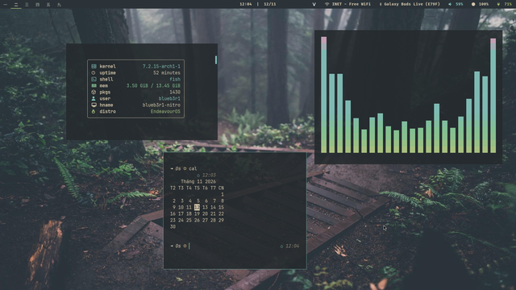

<div align="center">

# 🌲 blueb3r1-dotfiles

**---------------------------------------**


</div>

> [!NOTE]
> Dotfiles này được xây dựng dựa trên cảm hứng từ **[caelestia-shell](https://github.com/caelestia-dots/shell)** — kế thừa hệ thống **keybinds**, **biến môi trường (`env`)**, **decoration** và **animation** làm nền tảng cho Hyprland **Everforest**.

---

## 🖼️ Showcase

<div align="center">
  
</div>

---

## 🛠️ System

| Thành phần | Công cụ sử dụng |
| :--- | :--- |
| **Distro** |  |
| **Compositor / WM** |  |
| **Status Bar** |  |
| **Terminal** |  |
| **App Launcher** |  |
| **Notification** |  |
| **File Manager** |  |
| **System Fetch** |  |
| **Color Scheme** |  |

---

## 📦 Dependencies

### 1. Official repo
```bash
sudo pacman -S --needed hyprland waybar rofi-wayland swaybg mako libnotify hyprlock hypridle \
grim slurp wl-clipboard swappy hyprpicker brightnessctl wireplumber \
pavucontrol network-manager-applet blueman foot thunar dolphin fastfetch code \
fcitx5 fcitx5-configtool cliphist ydotool ttf-jetbrains-mono-nerd ttf-nerd-fonts-symbols papirus-icon-theme
```

### 2. AUR (sử dụng `yay`)
```bash
yay -S --needed google-chrome pwvucontrol sweet-cursors-git fcitx5-lotus
```

---

## 🚀 Hướng dẫn cài đặt

**1. Clone repository**
```bash
git clone https://github.com/blueb3r1/blueb3r1-dotfiles.git
cd blueb3r1-dotfiles
```

**2. Copy vào `~/.config/`**
```bash
cp -rf hypr waybar foot rofi mako thunar fastfetch gtk-4.0 ~/.config/
```

**3. Reload Hyprland**
```bash
hyprctl reload
```
**Or. Automation**
```bash
chmod +x setup.sh && ./setup.sh
```
---

## 🎨 Color scheme: Everforest

| Role | Hex | Preview |
| :--- | :--- | :--- |
| **Background** | `#2d353b` |  |
| **Foreground** | `#d3c6aa` |  |
| **Accent Green** | `#a7c080` |  |
| **Accent Yellow** | `#dbbc7f` |  |
| **Accent Red** | `#e67e80` |  |
| **Accent Blue** | `#7fbbb3` |  |

---

## 🙏 Credits & Tham khảo

- **[caelestia-shell](https://github.com/caelestia-dots/shell)**: Nguồn cảm hứng cho cấu trúc keybinds, biến môi trường, decoration và animation trên Hyprland.
- **[Everforest](https://github.com/sainnhe/everforest)**: Bảng màu chủ đạo cho toàn bộ hệ thống.